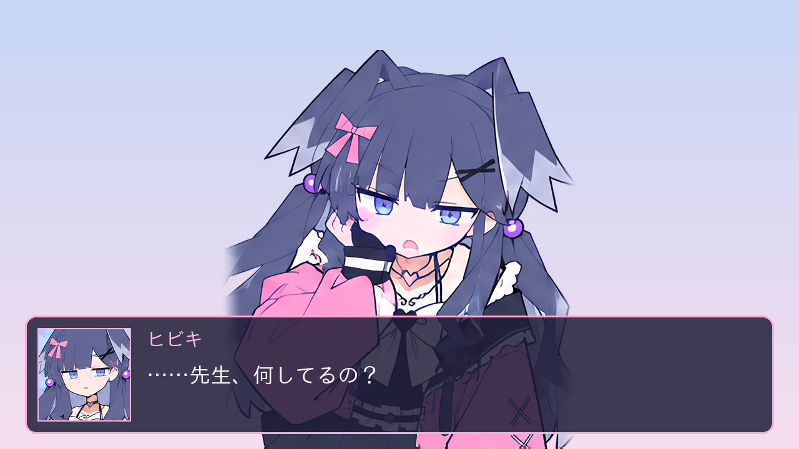

# ヒビキ 立ち絵セット

`source/sheet.png`（キャラクターシート）を元に、立ち絵と顔アイコンを切り出したものです。
新規の描き起こしはしておらず、シートの絵をそのまま使っています。



## 中身

| ファイル | 内容 | サイズ |
| --- | --- | --- |
| `tachie/hibiki_A.png` | 上半身 立ち絵A（シート22番、クリップボード） | 1036×1340 |
| `tachie/hibiki_B.png` | 上半身 立ち絵B（シート23番、頬杖） | 1196×1340 |
| `tachie/hibiki_SD.png` | SD 全身（シート24番） | 888×1193 |
| `tachie/hibiki_A_fade.png` / `hibiki_B_fade.png` | A/B の左右の切れ目をフェードさせた版 | 同上 |
| `face/face_NN_*.png` | 表情アイコン 21種（シート01〜21番） | 512×512 |
| `preview_sheet.png` | 一覧 | |
| `preview_scene.png` | ADV画面に置いたときのイメージ | |

- 立ち絵はすべて背景透過の PNG です。顔アイコンはシートの背景（効果線・記号）付きのままです。
- 元シートの解像度が低いため、Real-CUGAN（アニメ絵向けの超解像）で4倍にしています。

## 注意点

- A と B はシート上でパネル枠に左右と下が切られているため、その部分は元から絵がありません。
  下は画面下端やメッセージウィンドウで隠れる前提で、左右が気になるときは `_fade` 版を使ってください。
- 全身が欠けずに描かれているのは SD だけです。
- 表情差分の立ち絵（体はそのままで顔だけ差し替えたもの）はありません。シートの顔パネルと立ち絵では
  顔の向きや前髪の形が違うため、合成すると継ぎ目が目立ちます。必要なら A/B を参照画像にして
  画像生成で描き起こすことになります。

| 番号 | ファイル名 | 表情 |
| --- | --- | --- |
| 01 | normal | 通常 |
| 02 | smile | 笑顔 |
| 03 | wink | ウィンク |
| 04 | jitome | ジト目 |
| 05 | tsukkomi | つっこみ |
| 06 | akire | 呆れ |
| 07 | konwaku | 困惑 |
| 08 | tere | 照れ |
| 09 | ikari | 怒り |
| 10 | kanashii | 悲しい |
| 11 | odoroki | 驚き |
| 12 | kangaechu | 考え中 |
| 13 | fun | ふんっ |
| 14 | nemui | ねむい |
| 15 | shinken | 真剣 |
| 16 | niyari | ニヤリ |
| 17 | doya | ドヤ |
| 18 | aseri | 焦り |
| 19 | hiki | 引き |
| 20 | kiss | キス顔 |
| 21 | muhyoujou | 無表情 |

## 作り直し方

`tools/tachie/build.sh` で、このフォルダの PNG をすべて `source/sheet.png` から作り直せます。

```sh
sudo apt-get install -y libomp5
python3.12 -m venv .venv
.venv/bin/pip install realcugan-ncnn-py scipy pillow numpy opencv-python-headless
PY=.venv/bin/python tools/tachie/build.sh
```

- `realcugan-ncnn-py` は Python 3.12 までしか wheel がありません。GPU が無くても CPU で動きます（全体で2分ほど）。
- 背景透過は、パネルの外周から背景色を塗りつぶしたあと、輪郭のアンチエイリアス部分を背景色と分離して求めています。
  髪の隙間など外周とつながっていない背景は `--holes` で番号を指定しています。番号は
  `python holes.py <4倍画像> <確認用.png>` で確認できます。
